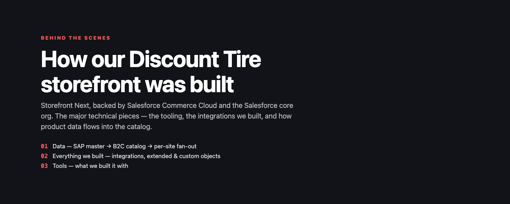
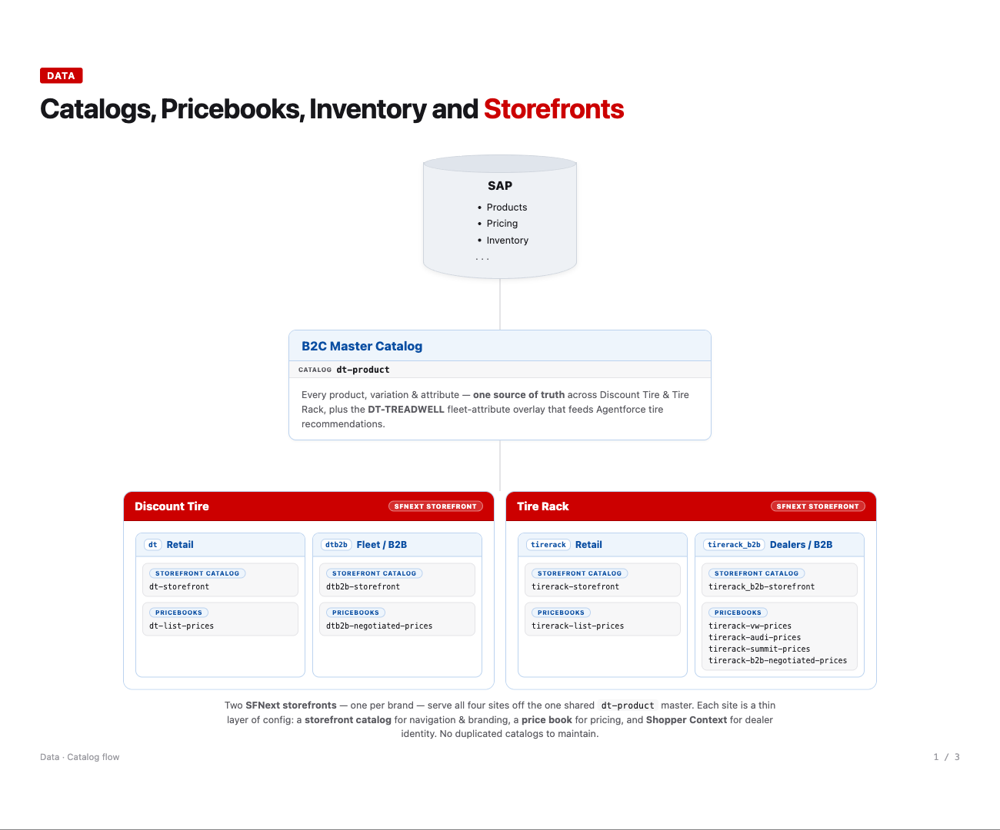
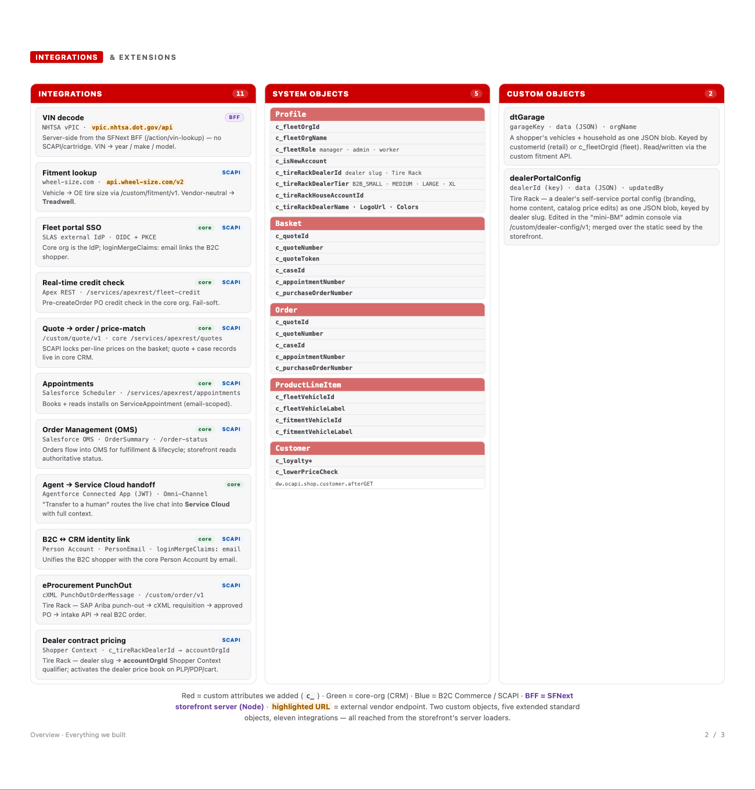
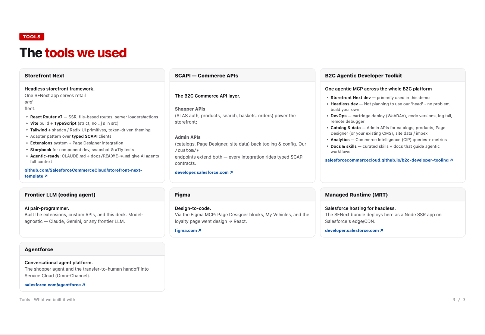

# Discount Tire · Behind the Scenes

How the Discount Tire & Tire Rack storefront was built on Salesforce — **Storefront Next** (React Router) backed by **B2C Commerce** and the **Salesforce core org**. The data flow, the integrations and custom objects we built, and the tooling behind it.

**▶ Interactive version:** https://tgrahn2.github.io/dt-demobuild/

---

## 1 · Data — SAP master → B2C catalog → per-site fan-out

## 2 · Everything we built — integrations, extended & custom objects

## 3 · Tools — what we built it with

